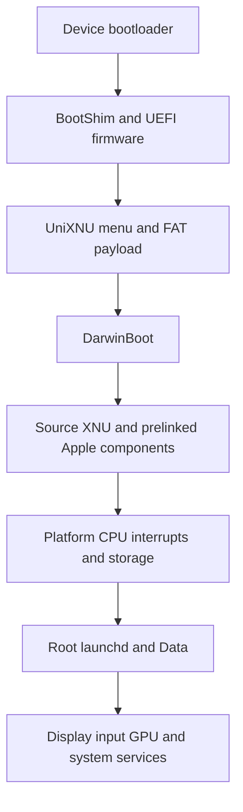

# Detailed SoC porting guide

Porting UniXNU to another SoC requires connecting UEFI, the XNU machine layer, native hardware drivers and the platform interfaces consumed by Apple userland. The boot manager, DarwinBoot, 4 KiB kernel patches, prelink tools and some IOKit drivers are reusable. The current storage, graphics and power paths retain explicit sheng dependencies. Start with an observable single-core kernel, add a read-only root and userland, then extend SMP, input and GPU support.

This page describes UniXNU `fb2bb310564ce66779e472a021881cf7c5764919` and its pinned submodules. The device reference is UniXNU-sheng `7562a779ebdbdedc17c4c7274ba993acbbec8188`; the firmware reference is uefi-sheng `8b7cc5d155ba147f461dea7121e91104544ab99e`. Runtime results for sheng refer to the project's records. They do not establish boot support for another SoC. A checkout directory named `SM8750` does not establish support for that chip either.

If the current goal is only a OnePlus 13T reaching UEFI and the UniXNU menu, start with the [first-stage menu guide](/porting/oneplus-13t-menu). The kernel, Apple userland and native-driver sections below belong to later stages.

## 1 Boot chain and porting boundaries



| Layer | Entry and implementation | Work for another SoC |
| --- | --- | --- |
| Boot image | `scripts/unixnu/bootimg.py`, firmware `BootShim/BootShim.S` | Establish image format, load addresses, firmware window and bootloader interface |
| UEFI | `scripts/unixnu/firmware.py`, device DSC/FDF and platform libraries | Establish the memory map, menu, file access and hardware handoff |
| Boot manager | `package/UniXNUPkg/Library/UniXNULib/` | Usually reusable; check volume discovery and loader protocol |
| Kernel loader | `drivers/DarwinBoot/DarwinBootPkg/Driver/` | Meet the EL1, Mach-O, ADT, memory-window and framebuffer contracts |
| XNU and prelink | `scripts/build-xnu-4k-baseline.sh`, `kits/NativePrelink/` | Preserve the 4 KiB and Apple binary ABI contracts; adapt machine-specific paths |
| Platform and hardware | `drivers/ArmDTPlatform/`, `drivers/ArmCpu/`, device drivers and kits | Describe real hardware and implement interrupts, DMA, storage, display and power |
| Userland | IPSW, userdata image, Data seed and Metal plugin | Meet root-volume, signing, platform-identity and service dependencies |

UEFI drivers run before boot services exit. Reading UFS, handling keys or drawing the menu establishes those capabilities at that stage. XNU needs its own drivers or a hardware-state takeover path verified on the target.

Full Apple userland also depends on original kernelcache components from an IPSW. The current path prelinks source XNU with selected Apple components. Public XNU source alone cannot produce the complete iPadOS system used by this path.

## 2 Check platform requirements first

| Condition | Current implementation | Work if it differs |
| --- | --- | --- |
| Boot permission | Execution of a custom ARM64 image | Establish a boot method allowed by the device |
| Exception level | DarwinBoot `Boot()` requires `CurrentEL == 4`, meaning EL1 | Implement and verify the firmware transition; removing the check does not establish a valid entry state |
| Page tables | Hardware supports the current 4 KiB granule path | Redesign the machine profile and page-size patches |
| Interrupts | `ArmCpu` currently parses and drives GICv3 | Implement a backend for GICv2 or another controller |
| Timer | Virtual architectural counter, virtual timer and PPI 27 | Verify firmware access permissions and adapt the timer/interrupt path if required |
| Memory | A sufficiently large contiguous `EfiConventionalMemory` run | Correct the real memory map, reduce occupancy or adjust the payload |
| Storage | A native XNU block-read path can be implemented | Develop the UFS, eMMC, NVMe or other transport |
| Debugging | At least one persistent way to observe the last checkpoint | Establish UART, framebuffer diagnostics or another board logging path first |

Another board using the same SoC still needs panel, touch, GPIO, power and partition work. A newer SoC from the same vendor requires fresh checks of clocks, power control, SMMU, storage and GPU. A different vendor can retain boot protocols and generic XNU layers, while replacing the Qualcomm GCC, RPMh, GENI and GMU paths as appropriate.

Set the first milestone to one core, verified timer interrupts and readable kernel checkpoints. Keep GPU, CPU frequency scaling, persistent Data and suspend disabled until then. A console itself needs a working UART or framebuffer path; `serial=3` selects behavior and does not supply a new UART driver.

## 3 Collect hardware facts

Preserve a working system and a recovery route before collecting the following data. Use the Linux BSP, the actual compiled board DTB and driver source to establish registers and initialization sequences. Observe the running stock system to establish the state firmware actually leaves behind.

| Item | Facts to establish | Affected implementation |
| --- | --- | --- |
| Bootloader | Accepted header, compression, DTB handoff, load limits and temporary boot method | BootShim and `[bootimg.image]` |
| DRAM | Physical regions, holes, reservations, secure-world and firmware use | UEFI memory map, DarwinBoot allocation and ADT |
| CPU | Per-core MPIDR, boot CPU, available cores, PSCI conduit and permissions | `/cpus`, `/psci` and secondary startup |
| Timer | `CNTFRQ_EL0`, counter access and timer PPI | CPU timebase, kernel time and interrupts |
| GIC | Version, GICD/GICR addresses and sizes, redistributor stride and non-secure permissions | `ArmCpu::mapGic()` and initialization |
| Storage | Host, PHY, clocks, reset, power, LUN, logical sectors and queue mode | Native block driver |
| IOMMU | SMMU version, base, stream IDs, contexts, address widths and permissions | DMA mappings and isolation |
| Display | Scanout address, pixel format, actual pitch, dimensions and panel retention | GOP, `boot_args.Video` and display driver |
| Input | Controller, bus, pins, reset, IRQ, firmware and coordinate orientation | Bus driver, touch protocol and HID |
| Power | Clock tree, regulators, votes, watchdog, idle and reset | Board power and recovery |
| GPU | Hardware, firmware, power, SMMU, commands and compiler support | Native GPU and userland plugin |
| Partitions | Actual GPT, LUN, userdata first/last LBA and logical block size | Userdata packing and persistence |

Example collection commands, where the device supports them and reading is permitted:

```sh
fastboot getvar product
fastboot getvar current-slot
fastboot getvar max-download-size
adb shell cat /proc/iomem
adb shell cat /proc/interrupts
adb shell ls -l /dev/block/by-name
dtc -I dtb -O dts -o board-observed.dts board-observed.dtb
```

The DTB extraction method is device specific. Android's runtime tree may contain bootloader fixups, so a similarly named BSP DTS is not an equivalent input. `fastboot getvar` does not necessarily expose partition geometry; inspect GPT and the actual block device separately.

## 4 Set up the device repository and build host

### Repository responsibilities

```text
workspace/
  UniXNU/                    Generic stack
  UniXNU-target/
    board.toml
    configs/target_defconfig
    scripts/                 Board generators and builders
    drivers/                 Device drivers and necessary generic overrides
    kits/
    package/                 Becomes kits/target in the build tree
    patches/                 Whole-module replacement rules apply
    .cache/firmware/          External inputs
  uefi-target/               Target Mu-Silicium port
```

In an existing main checkout:

```sh
git submodule update --init --recursive
git submodule status --recursive
cp -R examples/device ../UniXNU-target
```

Change the example's board name, SoC, kit, defconfig, UEFI configuration and paths. Remove `[board] example = true`, then supply real inputs. Leaving that flag enabled makes the driver refuse `build` and `bootimg`.

The complete host build depends on macOS and Xcode's `iphoneos` SDK. Python must be 3.11 or newer. Other tools include LLVM/lld, make, cmake, ninja, unifdef, mtools and dtc. Userdata and some seed tools use `hdiutil`. Linux/WSL can support source reading and applicable host checks; the current scripts do not provide a complete replacement Linux XNU cross-build flow.

```sh
./unixnu defconfig target_defconfig -D ../UniXNU-target
./unixnu status
./unixnu fetch
./unixnu tree
```

`defconfig` copies the source configuration to `out/target/.config`. Run it again after changing the source defconfig. Use `status` to inspect module origins; `fetch` writes the device's `unixnu.lock`. Generic submodules are pinned by main-repository gitlinks. Record device and UEFI commits separately too. Keep XNU/IPSW unchanged during initial porting instead of combining hardware bring-up with `fetch --update` and software upgrades.

### Overrides and script paths

Modules are selected by `(kind, name)`. Device `drivers/ArmCpu/` overrides the base ArmCpu, and device `patches/xnu/` replaces the entire base XNU patch set. To add board patches, retain the full base collection or explicitly extend the patch application logic. Placing a single patch in device `patches/xnu/` drops generic patches, including the 4 KiB work.

`tree.py` links drivers, kits and patches, and copies build scripts. Reassemble after edits and inspect the actual `out/target/tree/scripts/` contents. Device `package/` becomes `kits/<board.kit>`; its contents are not automatically copied wholesale into the EFI payload.

`kernel.py::build_archives()` prepends `tree/scripts/` to each archive builder entry. Use script names in `[kernel] archives`:

```toml
[kernel]
defconfig = "target_defconfig"
archives = [
  "build-corecrypto-14.py",
  "build-corecrypto-14.py --namespace",
  "build-arm-driver.py ArmDTPlatform",
  "build-arm-driver.py ArmCpu",
  "build-libpthread-kernel.py",
]
```

Do not use `scripts/build-arm-driver.py` here: it resolves to `tree/scripts/scripts/build-arm-driver.py`. Some existing documentation examples include that prefix; follow the current implementation and the actual sheng board file. The reference device repository supplies `build-arm-driver.py`; bring it into the new device and adapt it. This fragment illustrates a base archive order and is not a complete userland kernel recipe. By contrast, `firmware.preflight`, `payload.adt.tool` and `kernel.prelink.tool` resolve from the build-tree root and retain their `scripts/` or `kits/` prefix.

## 5 Bring up UEFI and the boot image

In `uefi-target/Resources/Configs/target.toml`, establish `[uefi_fd] base/size`, the BootShim header and Android image parameters. Put the actual board memory map and modules in DSC/FDF. Keep the firmware window clear of secure firmware, scanout, ramdisk, the BootShim source region and other memory still in use.

`bootimg.py` requires the FD length to match the configured size exactly, `_Payload` to equal the shim binary length, and the ARM64 header to match its inputs. Packing currently produces `gzip(BootShim + FD) + DTB`, then invokes Mu-Silicium's `mkbootimg.py`. It does not select arbitrary compression based on `kernel_compression`. The local 13T implementation adds v3/v4 unpacking checks and concatenated-DTB support; the baseline commit only checks legacy headers. Other headers, separate DTBs or vendor_boot still require corresponding packing and verification changes.

### Minimum usable firmware

| Interface | Behavior to verify |
| --- | --- |
| Text output or GOP | Menu and failures remain observable; text operation is possible without GOP |
| Simple Text Input | Menu can be operated; automatic boot replaces only some interactions |
| Simple File System | Configuration and kernel can be read from the payload FAT volume |
| Block I/O | Required block devices are accessible when the payload/storage design uses them |
| Loader protocol | DarwinBoot installs `gUniXNULoaderProtocolGuid` |
| UEFI memory services | Real free regions are allocatable; reservations are not handed to XNU |

Include these INF modules in the appropriate DSC/FDF or loading flow:

```text
UniXNUPkg/Application/UniXNU/UniXNU.inf
UniXNUPkg/Driver/UniXNUDxe/UniXNUDxe.inf
DarwinBootPkg/Driver/DarwinBoot.inf
```

First verify firmware and the menu with an empty ramdisk:

```sh
./unixnu build package
./unixnu build firmware --uefi ../uefi-target
./unixnu bootimg --uefi ../uefi-target --dtb /path/to/target.dtb --ramdisk none
fastboot boot out/target/boot/boot.img
```

These commands require an implemented target UEFI port. Use `fastboot boot` where temporary boot is supported; other platforms need a different launch container. This stage does not require flashing userdata.

### Hardware state after boot services exit

After exiting boot services, DarwinBoot masks exceptions, cleans the kernel window's cache state, invalidates instructions, disables the EL1 MMU and caches, puts the physical `boot_args` address in `x0` and branches to the physical kernel entry. Firmware must leave the transition code, data and framebuffer accessible under that handoff.

If the menu works but the display goes black at exit, check ExitBootServices callbacks that disable the panel, scanout memory reservations, display power and SMMU mappings. The sheng splash reservation and platform-security-library handling belong to that device's implementation.

## 6 Configure XNU and integrate drivers

Keep the current `DEVELOPMENT_ARM64_BCM2837` build profile initially. It supplies the 4 KiB layout while patches replace machine-specific behavior. A different SoC name does not require immediately changing `MACHINE_CONFIGS`. The current source version is XNU `10063.141.1`, Darwin `23.6.0`; driver objects use ordinary ARM64 subtype 0 and the iOS 17 target ABI.

An early single-core platform configuration can start with:

```text
CONFIG_XNU_SOURCE_CORECRYPTO14=y
CONFIG_XNU_SOURCE_PTHREAD=y
CONFIG_XNU_ARM_DT_PLATFORM=y
CONFIG_XNU_ARMCPU=y
CONFIG_XNU_NATIVE_ARCH_TIMER=y
# CONFIG_XNU_ARMVIRT_PLATFORM is not set
# CONFIG_XNU_NATIVE_UFS is not set
# CONFIG_XNU_NATIVE_ADRENO is not set
# CONFIG_XNU_BOOT_PROGRESS is not set
```

Match the crypto bootstrap mode to the selected prelinked components. Use `CONFIG_XNU_CRYPTO_BOOTSTRAP="prelinked"` when integrating the reference Apple crypto/AES path as required by that path. `CONFIG_XNU_NATIVE_PAN` requires the corresponding CPU capability. Avoid copying the complete sheng defconfig: it also enables owner root, graphics, verification-policy bundles and board power paths.

`XNU_BOOT_PROGRESS=1` currently requires UFS, owner-root audit, VirtIO and source corecrypto, and invokes a device-supplied builder. Start with UART or an adapted entry probe. Adding `boot-progress=2` alone does not build a generic progress layer.

Connect the full chain for a new built-in driver:

1. Supply source and real resource handling, validating lengths, addresses, IRQs and hardware state.
2. Build an archive using actual XNU `.cpo.json` compile records to preserve kernel macros, object layout and ABI.
3. Add the archive builder to `[kernel] archives`.
4. Add its switch, `KERNEL_EXTRA_ARCHIVES` and `KERNEL_ARCHIVE_DEPENDENCIES` to the kernel builder; use `-force_load` where required.
5. Patch the `KernelConfigTables.cpp` personality and pass the macro controlling it.
6. Publish the correct ADT provider and verify matching through `probe/start/registerService`.

Editing the reference `Info.plist` alone does not update a built-in personality. UniXNU can stage external kexts, but current DarwinBoot rejects requests with `KextCount != 0`. Use the existing static-link path for early target drivers.

When compile records are absent, the build driver first attempts a bootstrap compilation, builds the archives, then performs the final link and prelink. It tolerates a later bootstrap-pass error only after the required record exists. A failed final link remains a failed build.

## 7 Generate the target ADT

### Separate the two device-tree formats

FDT/DTB uses the standard flattened device-tree encoding consumed by bootloaders, UEFI and Linux. XNU's `.adt` uses Apple node encoding; `dtc` does not directly convert an FDT into it. DarwinBoot reads `kernel.macho.adt` beside the kernel and rejects an additional FDT passed in the request. Omit `dtb` from an XNU menu entry.

Use `node()` and CHRP NVRAM encoding from `scripts/qemu-entry/make-dt.py`, then study the device `make-sheng-adt.py` to implement the target generator. The QEMU tree includes fixture resources and compatibility nodes; copying that entire tree does not describe real target hardware.

| Node | Required target content |
| --- | --- |
| Root | `name=device-tree`, actual platform `compatible`, and `model/target-type` as needed by userland |
| `/chosen` | Fresh 64-byte `random-seed`, DRAM, OS environment and a usable CHRP NVRAM proxy |
| `/chosen/memory-map` | Zeroed 16-byte placeholders corresponding exactly to supplied inputs |
| `/cpus` | Boot CPU, later verified CPUs, actual MPIDR and timebase |
| `/arm-io` | Bus window and children encoded for current driver consumers |
| `/arm-io/intc` | GICv3 compatible, distributor/redistributor windows and any required stride |
| `/defaults`, `/options` | Nodes required by the platform expert; disable suspend appropriately while unsupported |
| `/psci` | Actual `smc` or `hvc` conduit when starting secondary CPUs |
| `/product`, `/buttons` | Product and button properties actually consumed by Apple components and userland |

`ArmDTPlatform::configure()` checks `/cpus`, `/arm-io`, `/defaults`, `/options` and the NVRAM proxy before calling the real `IODTPlatformExpert::configure()`. It creates nubs for `arm-io` children and attaches their service providers to the platform expert. Preserve that provider relationship so platform resource resolution works.

### Follow the exact field encoding

Apple node headers contain little-endian `u32 property_count, child_count`. Each property has a 32-byte name, little-endian length, data and padding to four bytes. Numeric data must also follow the individual reader's contract. Current `ArmCpu::mapGic()` requires exactly three `u64` values for `ranges`, four `u64` values for `reg`, and exactly NUL-terminated `arm,gic-v3` as its compatible value. Linux DT big-endian cells will not satisfy that contract unchanged.

The address transformation is:

```text
ranges = [child_base, parent_physical_base, window_size]
GIC reg = [dist_child_address, dist_size, redist_child_address, redist_size]
physical = parent_physical_base + child_address - child_base
```

The current interface has one such bus range. Devices outside it need an adapted resource model or verified board physical constants, as used by existing UFS code. The sheng UFS node supplies matching only: `GccUfs.h` supplies actual MMIO addresses. Adding a different node `reg` does not change the driver address.

### Identity and placeholders

`unique-chip-id` and chosen `chip-id` contribute to `IOPlatformUUID`; missing values can leave user processes waiting for a UUID. These are platform-identity inputs here. `[ipsw] chip_id/board_id` instead select an Apple BuildIdentity from the restore image. Manage target silicon identifiers, chosen identity seeds and IPSW identifiers separately. The reference generator parses `--chip-id` and `--unique-chip-id` as hexadecimal.

When supplying Data or a trust cache, generate matching zeroed `RAMDisk`, `PackedRAMDisk` or `TrustCache` address/length slots. `RAMDisk` and `PackedRAMDisk` are mutually exclusive. DarwinBoot checks the relationship between inputs and slots. Keeping packed Data also requires the native RAM block driver's subsequent decode path.

The generator must accept options passed by `payload.py`: `--output`, `--dram-size` and enabled board options for `--owned-memory-size`, `--cpu-regs`, `--psci-method`, identity, root UUID and placeholders. Adding a `board.toml` key alone does not make the packer forward it.

## 8 Memory windows and 4 KiB pages

Maintain three independent sets of values: actual device DRAM regions, the contiguous window DarwinBoot hands to XNU, and the address range each DMA device can access.

`AllocateWindow()` searches real `EfiConventionalMemory`, can merge adjacent free descriptors, and selects a physical base whose low 21 bits correspond to the kernel virtual base. The default window is 256 MiB. `/chosen/darwinboot-memory-size` can request 256 MiB through 8 GiB in 2 MiB steps. This changes a request; it cannot turn reservations or discontiguous DRAM into a usable contiguous run.

The window contains kernel segments, boot args, ADT, Data and trust caches, with trailing headroom. `Args->MemorySize` and `MemorySizeActual` both equal this window. Increasing `/chosen/dram-size` does not make the loader hand over all installed RAM. Mach-O input currently has a 128 MiB file limit, and segment-span validation still contains fixed 256 MiB-related bounds. Increasing the owned window does not relax those checks.

Choose a feasible window from the UEFI free map and actual payload size. For `NO WINDOW`, inspect the largest contiguous free run, address alignment and reservations before reducing the payload. Do not relabel MMIO, scanout or secure-world memory as ordinary RAM to satisfy allocation.

Preserve and understand these mechanisms:

| Patch or mechanism | Behavior to verify |
| --- | --- |
| `native-4k-bootstrap-capacity` | Enough bootstrap table pages for the selected mapping window |
| `native-4k-user-abi` | Consistent policies for kernel pages, user maps, commpage and shared regions |
| `native-4k-signature-hash-cache` | Validate original 16 KiB signing blocks before deriving 4 KiB digests |
| `zzx-pmap-sync-64bit-pa` | Physical addresses above 4 GiB retain their high bits across shifts |
| Non-Apple machine patches | Avoid Apple-only CPU tunables, monitor, UAT/SART and related paths |

For DMA, independently verify device widths, SMMU input/output widths, cache attributes and clean/invalidate operations. CPU access to high RAM does not establish UFS or GPU DMA access to it.

## 9 CPU GIC timer and SMP

Describe only the boot CPU initially. Verify `armcpu_registered`, `armcpu_gic_ready` and an increasing timer count. Current ArmCpu uses `CNTVCT_EL0` and `CNTV_*`; dispatch sends INTID 27 to `rtclock_intr`. Derive the timebase from the actual architectural counter, not the sheng frequency or the CPU clock.

GIC bring-up must verify the GICv3 system-register interface, Group 1 non-secure configuration, priority masks, GICD affinity routing and per-core redistributors. Stride may be inferred from hardware or set to one of the currently accepted explicit values: `0x20000`, `0x30000`, `0x40000`. Check frame walking against the target's accessible regions.

After single-core operation is stable:

1. Generate each CPU `reg` from actual MPIDR values and verify XNU's physical-to-logical numbering.
2. Review startup assembly in `native-smp-secondary.patch`. The current BCM2837 path retains only the low 16 MPIDR bits and raises `MAX_CPUS` to 8 while keeping a single-cluster configuration.
3. Adapt the reference ADT generator's validation. The sheng generator accepts boot CPU 0 and Affinity1-numbered CPUs only.
4. The current enable argument remains `sheng-smp=1`; PSCI conduit comes from `/psci`. Check CPU_ON results, secondary entry and each core's `armcpu_smp_step`.
5. Verify each core's timer and bidirectional IPI, then scheduling and TLB shootdown.

ArmCpu also contains eight-slot arrays, partial affinity comparisons and SGI target limits. More than eight CPUs, higher affinity levels or a different cluster layout require coordinated ADT, XNU numbering, assembly and driver changes. Increasing `MAX_CPUS` alone is insufficient.

`armcpu-spi-ipi=1` is the sheng alternative IPI path using SPIs 1008 through 1015. Verify standard SGIs on a new board first. Confirm those SPIs exist, are unused and can be routed correctly before considering this workaround. The current secondary resume path panics, so CPU_ON success does not establish suspend/resume support.

## 10 Storage DMA and the root volume

### Board dependencies in current UFS code

NativeUfs includes a real root-read path, but remains specific to sheng:

| Location | Current dependency | Porting action |
| --- | --- | --- |
| `NativeUfs::probe()` | `qcom,sm8550-ufshc` and a root-provider personality | Adapt matching, provider and startup order together |
| `GccUfs.h` | SM8550 host and GCC registers | Establish target registers and prerequisites |
| `NativeUfs.cpp` | apps SMMU physical window and UFS stream `0x60` | Verify SMMU version and stream routing |
| `SmmuTakeover.h` | SMMUv2 SMR/S2CR/context-bank layout and VA64 bypass | Implement controlled takeover or translation for the actual IOMMU |
| `RootLayout.h` | LUN 0, 4 KiB physical blocks, GPT and `SHNGROOT` | Match target media, image and sector format |

Existing host bring-up takes over a live controller and request list left by firmware, and handles device power state. It does not provide generic cold initialization for every controller. Verify cold boot and warm reset separately. UEFI reads do not establish that PHY, clocks, queues and SMMU remain correct after XNU takeover.

Verify controller identity, power/clock prerequisites, queue quiescence, DMA buffers, SMMU configuration, single-block reads, sequential reads, timeouts and errors before publishing IOMedia. Stop the old queue before takeover. Do not reuse a context bank still owned by another device. Retain address-width, stream-conflict and register-readback checks.

ArmSmmu4K implements ARM SMMUv2-related paths. SMMUv3 and other designs need their own stream/context/command-queue support even when they also support 4 KiB translation tables. Bypass remains subject to address widths and VA64 state.

### Image layout and block sizes

The userdata image begins with a `SHNGROOT` manifest, followed by 1 MiB-aligned IPSW OS and SystemOS disk windows. The original disk windows are exposed with 512-byte blocks. Current physical UFS/GPT reads use 4096-byte blocks, and XNU kernel pages are also 4096 bytes. Treat these as separate contracts.

The current GPT parser also validates header/entry CRCs, 128-byte entries, bounded entry counts and locations, partition bounds and READ(10) addressing. `[userdata] lba_bytes` changes the packer's capacity calculation but does not reconfigure the kernel storage parser. Different sectors, LUNs or queue formats require transport and parser changes together.

`root_match_volume_uuid` matches the actual published IOMedia UUID. An Android userdata GPT partition GUID is not a substitute. After changing the OS image, recheck APFS media/volume matching and keep verified-root policy, Data UUID and owner-mount configuration consistent.

Keep the root read-only initially. Later persistent Data and log writes require a new plan for the userdata tail, with no overlap with image windows or reserved logging areas. Leave board writeback arguments such as `sheng-data-persist=2` disabled during early bring-up.

### PMGR and payload checks

For `native-ufs-root=1`, `payload.py::check_native_root()` requires exactly one `sheng-pmgr=2` and checks `_sheng_pmgr_run` with `llvm-nm`. This is currently a sheng-specific native-root prerequisite. Implement and verify the platform provider required on the target, then make the check recognize it. Removing the check or renaming arguments does not satisfy original AMFI's PMGR dependency.

Reference ShengPlatformPower mainly establishes the ApplePMGR/ApplePMGRNub ABI and publication relationship. Unimplemented virtual methods stop explicitly. It is not the target SoC's complete power controller and cannot supply actual clocks, idle, reset or suspend.

## 11 Extend display input GPU and power

### Display

DarwinBoot `BootVideo.h` currently accepts only `PixelBlueGreenRedReserved8BitPerColor`. It derives row bytes from `PixelsPerScanLine * 4` and validates dimensions, capacity and addresses. A GOP exposing only BLT or another pixel format needs a compatible linear framebuffer or an extension of the full video-handoff path.

First retain firmware scanout for the kernel console, then integrate the NativeMobileDisplay legacy/GOP presenter, swap validation and retirement. Calibrate resolution, pitch, rotation, scaling and touch coordinates independently. Retained scanout and CPU framebuffer writes do not establish native DPU mode setting, vblank or resume.

### Input

Proceed through bus/pins, controller identification, firmware loading, valid contacts and HID publication. The sheng reference keeps board GPIO/clock facts in `TouchBoard.h`, hardware access in `TouchProbe.cpp`, protocol and pure processing separate, and publishes events through NativeHidInput.

NativeGeniSpi implements the Qualcomm GENI bus path. A different I2C/SPI controller or touch chip requires a replacement bus or protocol layer, with target reset, IRQ, DMA and matrix/coordinate parameters. Verify UEFI keys and XNU HID separately.

### GPU

The current runtime chain targets Adreno 740: `NativeMetal → metal2vulkan → Turnip/NIR/IR3 → Darwin KMD → NativeAdreno → GMU/CP/SMMU → scanout`. Board power and GMU configuration also live in the device package.

A different Adreno still requires checks of firmware ABI, HFI, power votes, registers, PM4, SMMU, compiler target and the userspace/kernel interface. Mali or another GPU needs a corresponding kernel driver and userland backend. Advance the system with CPU/simple display first. Then verify firmware startup, submission/fences, buffer mappings, pixels and Metal publication in order.

### Power

Implement actual clock/reset/regulator control, watchdog, thermal management and the system PMGR interface separately. Avoid unimplemented idle/suspend paths early. Stage each power sequence by its prerequisites, observing before writing. Even reading MMIO from an unpowered peripheral can stall the bus.

## 12 Apple binary ABI and external inputs

Keep the same XNU, IPSW, kernelcache and prelinked components during initial SoC work so hardware changes can be evaluated separately. Changing the userland release introduces another ABI adaptation task.

| Input or mechanism | Required consistency |
| --- | --- |
| `[ipsw]` | Product/version/build/device class/Apple chip and board identity |
| `kernelcache_sha256` | Decompressed original cache with the arm64 slice selected |
| Prelink roots and slide | Required component closure, imports and address layout |
| `early_security_init` | Real entry and metadata of the selected original security component |
| Original class bindings | C++ sizes, vtables, signatures and absolute addresses |
| Trust cache and verified-root bundle | Inputs and policies matching code and disk content |
| Data seed | Writable volume contents, UUID and required initialization state |

AES and other builders can use recorded original binding addresses in `scripts/data/`. The PMGR builder also reads a previous candidate kernel and report to check fixed original methods and vtables. These addresses belong to the pinned kernelcache. Re-establish the evidence when changing IPSW; updating hashes alone cannot make the bindings correct.

The complete sheng configuration also references policy archives not produced by its archive-builder list. In a clean workspace, establish the origin, generation procedure and policy for each `_ARCHIVE` input. `kernel.py` refuses missing files. Having all Git sources does not establish that these generated inputs are available.

The 4 KiB signing adaptation must still validate original 16 KiB signing blocks. `--owner-trust-cache` changes the packer's allow-list path and does not replace runtime validation. Current patches also include specific work-interval and GPU user-client sandbox policy changes. Retaining AMFI does not establish equivalence to Apple's native secure-boot system.

## 13 Build and boot in stages

After implementing target `board.toml`, ADT generation, archive builders and native drivers, run the stages on a macOS build host. Replace example input paths with actual target inputs.

```sh
./unixnu defconfig target_defconfig -D ../UniXNU-target
./unixnu status
./unixnu fetch
./unixnu tree
./unixnu ipsw info
./unixnu ipsw fetch
./unixnu build kernel
./unixnu build package
./unixnu build firmware --uefi ../uefi-target
```

`build kernel` includes prelink. If only the prelink selection changes, use `./unixnu build prelink`. It replaces that output and report, so preserve candidates needed for comparison first.

With an already qualified prelinked kernel, use `--kernel` to skip kernel compilation and exercise packaging:

```sh
./unixnu build payload --uefi ../uefi-target \
  --kernel /path/to/qualified-kernel.macho \
  --unique-chip-id "$TARGET_PLATFORM_SEED" \
  --trust-cache /path/to/qualified-trustcache.bundle \
  --data-ramdisk /path/to/qualified-data.dbr

./unixnu bootimg --uefi ../uefi-target --dtb /path/to/target.dtb
fastboot boot out/target/boot/boot.img
```

Set `TARGET_PLATFORM_SEED` to a valid hexadecimal identity value beforehand. Supply trust cache/Data only when the stage requires them, and generate matching ADT slots. The packer needs `payload.adt.tool` and `payload.dram_size`. Disable `payload.panic_screen` initially until the target entry probe is adapted. The reference probe comes from the device repository and includes addresses/counter constants tied to a known kernel.

The payload generator recreates `unixnu.toml` with kit autoload disabled. Device package contents and manual staging edits are not automatically preserved. An extra `--kernel-arg NAME=VALUE` replaces a board argument with the same name; the generated command line has a 1000-byte limit. Do not copy the full sheng argument list into an initial target build.

Build userdata:

```sh
./unixnu build userdata --dry-run
./unixnu build userdata
```

Current `--dry-run` primarily reads IPSW member information and declared partition capacity. It does not expand disk images or perform the final expanded-image fit check. The real build obtains expanded sizes with `hdiutil imageinfo` before checking actual capacity.

Flashing `userdata-root.img` replaces Android userdata content. Back up data and confirm recovery, partition and capacity first. Deploy only after the target storage and root path have been verified:

```sh
fastboot flash userdata out/target/userdata/userdata-root.img
fastboot reboot bootloader
fastboot boot out/target/boot/boot.img
```

Temporary boot does not flash the boot partition, but the running kernel may still write storage. Keep native writeback disabled while verifying the boot chain alone.

## 14 Acceptance and fault isolation

| Stage | Acceptance criterion | Next check after failure |
| --- | --- | --- |
| BootShim/UEFI | Repeatable firmware entry with sustained output | Header, source/destination overlap, FD size, cache and entry |
| UniXNU | `UNIXNU:` logs, parsed configuration and expected entries | FAT/ramdisk, configuration path, kit matching and load order |
| DarwinBoot | Loader v2 installed, inputs validated, sensible handoff addresses | EL1, protocol, Mach-O, ADT, slots and allocation window |
| Kernel entry | An identifiable entry or machine-init checkpoint | `x0`, physical mappings, table budget, exceptions and video/UART |
| Single-core platform | Platform configured and real timer IRQ count increases | ADT bytes, GIC, PPI, counter frequency and permissions |
| Block reads | Repeatable known data with explainable failures | Power, clocks, queues, DMA/SMMU, cache and timeout |
| Root | Correct IOMedia, UUID and root binding; launchd executes | Manifest, windows, APFS, policies and signing |
| Userland | Data mounted and required processes remain running | pthread/crypto, platform UUID, PMGR and watchdog |
| SMP | Every CPU schedules, with timer and bidirectional IPI evidence | MPIDR, PSCI, GICR, SGI and TLB shootdown |
| Graphics/input | Correct actual frames, coordinates and events | Pitch/format, synchronization, bus, HID and compositor |
| Sustained operation | Repeated cold/warm boots, stress and error recovery pass | Resource retirement, clocks, power and persistence consistency |

The DarwinBoot green bar establishes that its entry-handoff code ran. `inputs validated; exiting boot services` does not establish XNU execution. `armdt_platform_*` counters describe platform nubs, not successful startup of every child driver. Enumerating a Metal device does not establish GPU correctness or stability.

Isolate common failures at their transition boundary:

| Symptom | Check first |
| --- | --- |
| Menu works; DarwinBoot returns Unsupported | EL, nonempty FDT, staged kexts or unsupported GOP format |
| Compromised Data | ADT size/encoding, duplicate fields or Data/trust input-slot mismatch |
| NO WINDOW | Actual contiguous conventional memory, alignment and requested size |
| Handoff stalls and timer is absent | GIC/PPI, firmware traps and frequency; independently verify the log channel |
| No PMGR | Original security-component dependencies, provider publication and ABI |
| Low addresses work; high-address DMA fails | Device/SMMU widths, VA64, truncation and cache |
| No root device | GPT/LUN/sectors, manifest, IOMedia UUID and policy |
| configd or another process waits | Platform UUID inputs/publication, then the actual wait stack |
| Warm boot sometimes works; cold boot fails | Firmware residue, PHY/clocks, SMMU and queue takeover |

## 15 Checks and their scope

Source inspection, packaging checks, QEMU tests and hardware boots establish different facts. `hardware_tested: false` in `boot.json`, `payload.json` and userdata reports does not change because an artifact was built successfully.

| Check | Prerequisites and scope |
| --- | --- |
| `git submodule status --recursive`, `unixnu status` | Establish source and module origins, not bootability |
| Built-in `bootimg.py` verify | Round-trip the current header, gzip, FD, DTB and ramdisk |
| `check-xnu-granules.py` | Requires the corresponding XNU source/toolchain; checks granule fields |
| `check-native-4k-policy.py` | Requires patched source; executes the extracted page-size policy |
| `check-code-signing-granules.py` | Requires source and Xcode; checks the signing-page gate, not the entire validator |
| `check-darwinboot-window-parser.py` | Requires the reference device ADT helper and clang; exercises the parser without UEFI allocation |
| `test-armcpu.py` | Requires a runnable kernel/QEMU fixture; checks CPU, timer, missing GIC and commpage |
| Storage/touch/SMMU host tests | Check pure logic, bounds and refusals without driving real hardware |

Run applicable scripts in the assembled tree with their prerequisites installed, for example:

```sh
cd out/target/tree
python3 scripts/check-xnu-granules.py
python3 scripts/check-native-4k-policy.py
python3 scripts/check-code-signing-granules.py
```

Some historical fixtures still reference old build directories. Inspect their inputs against current artifacts before use. Missing historical reports are not target failures, and existing QEMU PASS results are not hardware acceptance. QEMU's PSCI, GIC, VirtIO and memory model do not cover target power sequencing, UFS PHY, SMMU stream permissions or panel retention.

## 16 Implementation order for a new platform

For SM8750 or another platform without confirmed support:

1. Complete the hardware facts and recovery plan; identify actual UEFI, DTB, memory and CPU interfaces.
2. Create a separate device repository, retain the Apple software baseline and account for all external inputs.
3. Boot target UEFI and the empty-payload menu; calibrate GOP/logging and verify EL1 handoff prerequisites.
4. Complete single-core ADT and machine adaptation so timer and platform initialization repeat reliably.
5. Implement target storage/DMA, validate read-only data, then satisfy Apple provider/PMGR and root dependencies.
6. Mount root and Data, run launchd, then bring up display services and input.
7. Add SMP, CPU power and GPU independently; enable persistent writes and sustained-operation testing last.

Keep reconstructible configuration, input versions and logs for each stage. Describe support by stages actually passed. Suspend, USB, wireless, audio and sensors remain separate work when unimplemented; reaching a desktop does not complete them.

## Source index

| Topic | Pinned source |
| --- | --- |
| Build dispatch, module resolution and packaging | [UniXNU build driver](https://github.com/UniXNU/UniXNU/tree/fb2bb310564ce66779e472a021881cf7c5764919/scripts/unixnu) |
| Kernel switches and linking | [build-xnu-4k-baseline.sh](https://github.com/UniXNU/UniXNU/blob/fb2bb310564ce66779e472a021881cf7c5764919/scripts/build-xnu-4k-baseline.sh), [XNU patches](https://github.com/UniXNU/UniXNU/tree/fb2bb310564ce66779e472a021881cf7c5764919/patches/xnu) |
| UEFI menu handoff | [UniXNULib](https://github.com/UniXNU/UniXNU/tree/fb2bb310564ce66779e472a021881cf7c5764919/package/UniXNUPkg/Library/UniXNULib) |
| Kernel loading, windows and video | [DarwinBoot](https://github.com/UniXNU/DarwinBoot/tree/85332b317ee80898fc78939ea64e6ca52d3837a3/DarwinBootPkg/Driver) |
| ADT platform expert | [ArmDTPlatform.cpp](https://github.com/UniXNU/ArmDTPlatform/blob/0d544705c2e89725caabc0542bb96bc8febd8c70/ArmDTPlatform.cpp) |
| CPU, GIC and timer | [ArmCpu.cpp](https://github.com/UniXNU/ArmCpu/blob/1951cc8444b340d7d8879e9418220cf29eb711d7/ArmCpu.cpp) |
| Storage, queues and GPT | [NativeUfs](https://github.com/UniXNU/NativeUfs/tree/af785c1777161a62931425c2faaa536ce0bebd5b) |
| SMMUv2 | [ArmSmmu4K](https://github.com/UniXNU/ArmSmmu4K/tree/4d0d6598b1a36aeec3de01091893fa6660e49388) |
| Prelink | [NativePrelink](https://github.com/UniXNU/NativePrelink/tree/3380d3006068cdaab69454b37668e6b532ed2584) |
| Device configuration, ADT, PMGR and probes | [UniXNU-sheng](https://github.com/UniXNU/UniXNU-sheng/tree/7562a779ebdbdedc17c4c7274ba993acbbec8188) |
| BootShim, memory map and firmware modules | [uefi-sheng](https://github.com/UniXNU/uefi-sheng/tree/8b7cc5d155ba147f461dea7121e91104544ab99e) |

Related: [Device repository](/porting/device-repository), [Device tree](/porting/device-tree), [4 KiB pages](/xnu/four-k-page-tables), [XNU drivers](/drivers/xnu-drivers), [Troubleshooting](/reference/troubleshooting).
