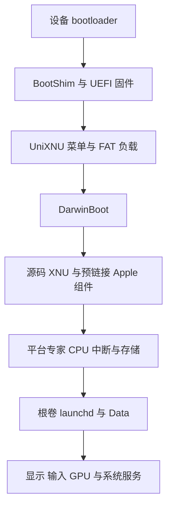

# 跨 SoC 移植详细指南

UniXNU 的跨 SoC 移植需要同时接通 UEFI、XNU 的机器相关代码、原生硬件驱动和 Apple 用户态所需的平台接口。可复用的基础包括启动管理器、DarwinBoot、4 KiB 内核补丁、预链接工具及部分 IOKit 驱动；当前存储、图形和电源路径仍有明确的 sheng 依赖。新设备应先实现可观察的单核内核启动，再接入只读根卷和用户态，最后扩展多核、输入和 GPU。

本页对应 UniXNU `fb2bb310564ce66779e472a021881cf7c5764919` 及其固定的子模块提交。参考设备源码是 UniXNU-sheng `7562a779ebdbdedc17c4c7274ba993acbbec8188`，参考 UEFI 是 uefi-sheng `8b7cc5d155ba147f461dea7121e91104544ab99e`。sheng 的运行结果沿用项目记录；本页不代表其它 SoC 已经通过启动验证。目录名包含 `SM8750` 也不构成该芯片已适配的证据。

若目标仅是一加 13T 进入 UEFI 与 UniXNU 菜单，先使用[首阶段菜单启动指南](/zh/porting/oneplus-13t-menu)。以下内核、Apple 用户态和原生驱动章节属于后续阶段。

## 1 启动链与移植边界



| 层次 | 入口与实现 | 新 SoC 的工作 |
| --- | --- | --- |
| 启动镜像 | `scripts/unixnu/bootimg.py`、UEFI 仓库的 `BootShim/BootShim.S` | 确定镜像格式、加载地址、固件窗口和 bootloader 接口 |
| UEFI | `scripts/unixnu/firmware.py`、设备 DSC/FDF、平台库 | 建立内存图，提供菜单、文件访问和硬件交接 |
| 启动管理器 | `package/UniXNUPkg/Library/UniXNULib/` | 通常复用；检查卷发现和加载器协议 |
| 内核加载器 | `drivers/DarwinBoot/DarwinBootPkg/Driver/` | 满足 EL1、Mach-O、ADT、内存窗口和 framebuffer 约定 |
| XNU 与预链接 | `scripts/build-xnu-4k-baseline.sh`、`kits/NativePrelink/` | 保持 4 KiB 与 Apple 二进制 ABI，适配机器相关路径 |
| 平台与硬件 | `drivers/ArmDTPlatform/`、`drivers/ArmCpu/`、设备驱动与 kit | 描述真实硬件，实现中断、DMA、存储、显示和电源 |
| 用户态 | IPSW、userdata 镜像、Data seed、Metal 插件 | 满足根卷、代码签名、平台身份和服务依赖 |

UEFI 驱动运行在退出 boot services 之前。UEFI 能读 UFS、响应按键或绘制菜单，只能证明这一阶段具备对应能力。XNU 需要自己的硬件驱动，或经过验证的硬件状态接管路径。

完整 Apple 用户态还依赖 IPSW 中的原始 kernelcache 组件。当前路径将源码 XNU 与选中的 Apple 组件预链接，不能仅凭公开 XNU 源码生成完整 iPadOS 系统。

## 2 先判断目标平台是否满足条件

| 条件 | 当前实现的要求 | 不满足时的工作 |
| --- | --- | --- |
| 启动权限 | 能执行自行构建的 ARM64 镜像 | 先解决设备允许的启动方式 |
| 异常级别 | DarwinBoot 的 `Boot()` 要求 `CurrentEL == 4`，即 EL1 | 在固件交接中实现并验证降级；删除检查无法建立正确入口状态 |
| 页表 | 硬件支持当前 4 KiB granule 路径 | 重新设计机器配置及其页大小补丁 |
| 中断 | `ArmCpu` 当前解析并驱动 GICv3 | GICv2 或其它控制器需要对应后端 |
| 定时器 | 当前路径使用虚拟架构计数器、虚拟定时器与 PPI 27 | 校验固件是否开放访问，必要时适配定时器及中断路径 |
| 内存 | UEFI 中存在足够大的连续 `EfiConventionalMemory` 区域 | 修正真实内存图、减少占用或调整负载 |
| 存储 | 新硬件上可实现 XNU 原生块读取 | 开发 UFS、eMMC、NVMe 或其它传输层 |
| 调试 | 至少有一种可持续记录最后检查点的方式 | 先完成 UART、framebuffer 诊断或其它板级日志 |

同一 SoC 的另一块板子通常还要重新适配面板、触控、GPIO、供电和分区。同一厂商的新 SoC 需要重新核对时钟、电源控制、SMMU、存储控制器和 GPU。跨厂商平台可以保留启动协议与 XNU 通用层，但 Qualcomm 的 GCC、RPMh、GENI 和 GMU 代码需要按目标硬件替换。

首个里程碑设为“单核、已验证的定时器中断、可读取的内核检查点”。达到它之前，保持 GPU、CPU 调频、持久 Data 和休眠路径关闭。控制台输出本身也需要串口或 framebuffer 的实际适配，`serial=3` 只是参数，不能提供新 UART 驱动。

## 3 收集目标硬件资料

先保留设备能够正常运行的系统与恢复途径，再收集下列资料。Linux BSP、编译后的实际设备 DTB 和驱动源码用于确认寄存器及初始化序列；原系统启动后的观测用于确认固件实际留下的状态。

| 项目 | 必须确认的内容 | 最终影响 |
| --- | --- | --- |
| bootloader | 支持的镜像 header、压缩、DTB 交接、加载限制、临时启动方式 | BootShim、`[bootimg.image]` |
| DRAM | 实际物理区间、空洞、保留区、安全世界与固件占用 | UEFI 内存图、DarwinBoot 分配、ADT |
| CPU | 每核 MPIDR、启动核、可用核心、PSCI conduit 与权限 | `/cpus`、`/psci`、secondary 启动 |
| 定时器 | `CNTFRQ_EL0`、计数器访问、定时器 PPI | CPU timebase、内核时间与中断 |
| GIC | 版本、GICD/GICR 地址与长度、redistributor stride、非安全中断权限 | `ArmCpu::mapGic()` 和初始化 |
| 存储 | 控制器、PHY、时钟、reset、电源、LUN、逻辑扇区、队列模式 | 原生块驱动 |
| IOMMU | SMMU 版本、基址、stream ID、context、地址宽度与权限 | DMA 映射及隔离 |
| 显示 | 扫描输出地址、像素格式、真实 pitch、尺寸、面板保活条件 | GOP、`boot_args.Video`、显示驱动 |
| 输入 | 控制器型号、总线、引脚、reset、IRQ、固件及坐标方向 | 总线驱动、触控协议和 HID |
| 电源 | 时钟树、稳压器、vote、watchdog、idle 与 reset | 板级电源及恢复 |
| GPU | 硬件型号、固件、供电、SMMU、命令格式和编译器支持 | 原生 GPU 与用户态插件 |
| 分区 | 真实 GPT、LUN、userdata 首尾 LBA、逻辑块大小 | userdata 打包与持久化 |

示例采集命令在设备支持、具备相应读取权限时使用：

```sh
fastboot getvar product
fastboot getvar current-slot
fastboot getvar max-download-size
adb shell cat /proc/iomem
adb shell cat /proc/interrupts
adb shell ls -l /dev/block/by-name
dtc -I dtb -O dts -o board-observed.dts board-observed.dtb
```

DTB 的提取方式由设备决定。Android 运行时 DT 可能已经带有 bootloader fixup，不能直接用 BSP 中某个同名 DTS 代替。`fastboot getvar` 也不保证提供分区几何；GPT 和实际块设备仍需分别核对。

## 4 建立设备仓库与构建环境

### 仓库分工

```text
workspace/
  UniXNU/                    通用栈
  UniXNU-target/
    board.toml
    configs/target_defconfig
    scripts/                 板级生成器和构建脚本
    drivers/                 设备驱动及通用驱动的必要覆盖
    kits/
    package/                 在构建树中成为 kits/target
    patches/                 注意整模块覆盖规则
    .cache/firmware/          外部输入
  uefi-target/               目标设备的 Mu-Silicium 移植
```

已有主仓库执行：

```sh
git submodule update --init --recursive
git submodule status --recursive
cp -R examples/device ../UniXNU-target
```

修改示例的板名、SoC、kit、defconfig、UEFI 配置和路径，移除 `[board] example = true`，再填写真实输入。保留该标志时，构建驱动会主动拒绝 `build` 和 `bootimg`。

主机构建链依赖 macOS 与 Xcode 的 `iphoneos` SDK。Python 需要 3.11 或更新，另外需要 LLVM/lld、make、cmake、ninja、unifdef、mtools 和 dtc。userdata 与部分 seed 工具使用 `hdiutil`。Linux/WSL 可以承担阅读和适用的主机检查，当前脚本没有提供完整的 Linux XNU 交叉构建替代流程。

```sh
./unixnu defconfig target_defconfig -D ../UniXNU-target
./unixnu status
./unixnu fetch
./unixnu tree
```

`defconfig` 把配置复制到 `out/target/.config`。后续修改源 defconfig 后要重新运行该命令。`status` 用于检查模块来源；`fetch` 写设备仓库的 `unixnu.lock`。通用子模块由主仓库 gitlink 固定，UEFI 与设备仓库也应分别记录提交。首次移植不要同时执行 `fetch --update` 和升级 XNU/IPSW。

### 覆盖与脚本路径

模块按 `(kind, name)` 选择。设备的 `drivers/ArmCpu/` 覆盖基础 `ArmCpu`，设备的 `patches/xnu/` 同样会替换整个基础 XNU 补丁集。需要新增板级补丁时，应保留完整基础补丁集合，或明确扩展补丁应用逻辑；只放一个补丁到设备 `patches/xnu/` 会丢失通用 4 KiB 等补丁。

`tree.py` 链接驱动、kit 和补丁，复制构建脚本。修改后重新组装，并检查 `out/target/tree/scripts/` 实际使用的内容。设备 `package/` 成为 `kits/<board.kit>`，不会自动作为 EFI payload 的全部内容被复制。

`kernel.py::build_archives()` 在条目前添加 `tree/scripts/`，因此 `[kernel] archives` 使用脚本名：

```toml
[kernel]
defconfig = "target_defconfig"
archives = [
  "build-corecrypto-14.py",
  "build-corecrypto-14.py --namespace",
  "build-arm-driver.py ArmDTPlatform",
  "build-arm-driver.py ArmCpu",
  "build-libpthread-kernel.py",
]
```

这里不要写 `scripts/build-arm-driver.py`，否则会查找 `tree/scripts/scripts/build-arm-driver.py`。已有部分文档示例带此前缀，应以当前代码和 sheng 实际板级文件为准。`build-arm-driver.py` 在参考设备仓库中提供，需要引入并按新设备裁剪；上面的片段只说明基础 archive 顺序，不承诺独立构建完整用户态内核。`firmware.preflight`、`payload.adt.tool` 和 `kernel.prelink.tool` 则相对构建树根目录解析，仍应带 `scripts/` 或 `kits/`。

## 5 先完成 UEFI 与启动镜像

在 `uefi-target/Resources/Configs/target.toml` 确定 `[uefi_fd] base/size`、BootShim header 和 Android 镜像参数，在 DSC/FDF 中配置真实板级内存图与模块。固件窗口必须避开安全固件、扫描输出、ramdisk、BootShim 来源区和其它仍在使用的内存。

`bootimg.py` 检查固件长度恰好等于配置大小，检查 `_Payload` 等于 shim 二进制长度，并检查 ARM64 header。当前打包逻辑固定生成 `gzip(BootShim + FD) + DTB`，随后用 Mu-Silicium 的 `mkbootimg.py` 打包。它并不根据 `kernel_compression` 自动选择任意压缩格式。本地 13T 实现已补齐 v3/v4 解包检查并支持连续 DTB 集合；基准提交只有旧 header 的校验路径。目标需要其它 header、独立 DTB 或 vendor_boot 时，仍须修改相应打包和校验代码。

### 最小可用固件

| 接口 | 需要验证的行为 |
| --- | --- |
| 文本输出或 GOP | 能持续观察菜单与错误；无 GOP 时可走文本路径 |
| Simple Text Input | 能操控菜单；自动启动仅能替代部分操作 |
| Simple File System | 能读取 payload FAT 中的配置和内核 |
| Block I/O | payload 或存储方案依赖块设备时可访问相应设备 |
| Loader protocol | DarwinBoot 安装 `gUniXNULoaderProtocolGuid` |
| UEFI 内存服务 | 真实空闲区可分配，保留区不会被交给内核 |

把以下 INF 纳入正确的 DSC/FDF 或对应加载流程：

```text
UniXNUPkg/Application/UniXNU/UniXNU.inf
UniXNUPkg/Driver/UniXNUDxe/UniXNUDxe.inf
DarwinBootPkg/Driver/DarwinBoot.inf
```

先用空 ramdisk 验证固件和菜单：

```sh
./unixnu build package
./unixnu build firmware --uefi ../uefi-target
./unixnu bootimg --uefi ../uefi-target --dtb /path/to/target.dtb --ramdisk none
fastboot boot out/target/boot/boot.img
```

这些命令以已完成的目标 UEFI 移植为前提。bootloader 支持临时启动时可用 `fastboot boot`，其它平台要替换启动外壳。此阶段不需要刷写 userdata。

### 退出 boot services 后的硬件状态

DarwinBoot 退出 boot services 后屏蔽异常，清理内核窗口缓存、失效指令缓存、关闭 EL1 MMU 和 cache，再把 `boot_args` 物理地址放在 `x0`，跳转至内核物理入口。固件应使该段代码、数据和 framebuffer 在交接时仍可正确访问。

菜单显示正常但退出后黑屏时，检查面板是否被 ExitBootServices 回调关闭、扫描输出内存是否保留，以及显示电源和 SMMU 映射是否仍有效。sheng 的 splash 保留节点和平台安全库处理属于该设备方案，不能原样推广。

## 6 内核配置与驱动接入

保留当前 `DEVELOPMENT_ARM64_BCM2837` 构建配置。这里借用 BCM2837 的 4 KiB 布局，再用补丁替换机器相关行为；更换 SoC 名称不要求先把 `MACHINE_CONFIGS` 改成目标芯片名。当前源码版本为 XNU `10063.141.1`，Darwin `23.6.0`，驱动对象按普通 ARM64 subtype 0、iOS 17 目标 ABI 构建。

早期单核平台配置可以从以下开关起步：

```text
CONFIG_XNU_SOURCE_CORECRYPTO14=y
CONFIG_XNU_SOURCE_PTHREAD=y
CONFIG_XNU_ARM_DT_PLATFORM=y
CONFIG_XNU_ARMCPU=y
CONFIG_XNU_NATIVE_ARCH_TIMER=y
# CONFIG_XNU_ARMVIRT_PLATFORM is not set
# CONFIG_XNU_NATIVE_UFS is not set
# CONFIG_XNU_NATIVE_ADRENO is not set
# CONFIG_XNU_BOOT_PROGRESS is not set
```

crypto bootstrap 模式要与预链接组件选择一致；接入参考 Apple crypto/AES 路径时再按其要求使用 `CONFIG_XNU_CRYPTO_BOOTSTRAP="prelinked"`。`CONFIG_XNU_NATIVE_PAN` 需要目标 CPU 支持对应能力。不要直接复制 sheng 完整 defconfig，它同时启用 owner root、图形、验证策略包和设备电源路径。

`XNU_BOOT_PROGRESS=1` 当前要求 UFS、owner-root audit、VirtIO 和源码 corecrypto，并调用设备提供的构建脚本。新板可先使用串口或已适配的入口探针；仅添加 `boot-progress=2` 不会自动构建通用进度层。

新增内置驱动需要接通以下完整链路：

1. 提供源文件和真实资源读取，校验长度、地址、IRQ 与硬件状态。
2. 用实际 XNU `.cpo.json` 编译记录构建静态库，保持内核的宏、对象布局和 ABI。
3. 把 archive 构建脚本加入 `[kernel] archives`。
4. 在内核构建脚本中加入开关、`KERNEL_EXTRA_ARCHIVES` 与 `KERNEL_ARCHIVE_DEPENDENCIES`；按需要使用 `-force_load`。
5. 通过补丁更新 `KernelConfigTables.cpp` 的 personality，并传入控制它的宏。
6. 在 ADT 发布正确的 provider，在 `probe/start/registerService` 路径验证匹配和启动。

只改参考 `Info.plist` 不会修改内置 personality。UniXNU 可以暂存外部 kext，但当前 DarwinBoot 在 `KextCount != 0` 时拒绝请求；新板早期驱动应沿已有静态链接路径集成。

构建驱动在首次缺少编译记录时先尝试一轮 bootstrap 编译，再构建 archive，最后完整链接和预链接。首轮仅在成功产生所需记录后才允许容忍后续错误；最终链接失败仍然是失败。

## 7 生成目标设备 ADT

### 区分两种设备树

FDT/DTB 使用标准扁平设备树编码，供 bootloader、UEFI 和 Linux 使用。XNU 的 `.adt` 使用 Apple 节点编码，不能用 `dtc` 直接转换得到。当前 DarwinBoot 从内核路径旁读取 `kernel.macho.adt`，并拒绝请求中额外传入的 FDT。XNU 菜单项应省略 `dtb`。

参考 `scripts/qemu-entry/make-dt.py` 的 `node()` 和 CHRP NVRAM 编码，再对照设备仓库 `make-sheng-adt.py` 实现目标生成器。QEMU 示例中包含测试专用资源与兼容性节点，整棵树不能作为真实板子的硬件描述。

| 节点 | 目标生成器应提供的内容 |
| --- | --- |
| 根节点 | `name=device-tree`，真实平台 `compatible`，按用户态需求设置 `model/target-type` |
| `/chosen` | 新的 64 字节 `random-seed`、DRAM、OS environment、可用 CHRP NVRAM proxy |
| `/chosen/memory-map` | 与实际输入一一对应的 16 字节全零占位符 |
| `/cpus` | 启动核及之后验证过的核心，真实 MPIDR 与 timebase |
| `/arm-io` | 按当前驱动约定编码的总线窗口和子设备 |
| `/arm-io/intc` | GICv3 compatible、distributor/redistributor 窗口和必要 stride |
| `/defaults`、`/options` | 平台专家要求的节点；未实现休眠时设置相应禁用策略 |
| `/psci` | 启动多核时使用实际的 `smc` 或 `hvc` conduit |
| `/product`、`/buttons` | Apple 平台组件与用户态实际读取的产品及按钮属性 |

`ArmDTPlatform::configure()` 先检查 `/cpus`、`/arm-io`、`/defaults`、`/options` 和 NVRAM proxy，再调用真正的 `IODTPlatformExpert::configure()`。它为 `arm-io` 子节点创建 nub，并把 service provider 连接到平台专家。移植时保留这一 provider 关系，才能沿平台专家解析资源。

### 精确遵守当前字段编码

Apple 节点头为小端 `u32 property_count, child_count`；属性名固定 32 字节，随后是小端长度、属性字节和 4 字节填充。数值还需遵守具体读取者的约定。当前 `ArmCpu::mapGic()` 要求 `ranges` 正好是三个 `u64`，`reg` 正好是四个 `u64`，`compatible` 正好为带 NUL 的 `arm,gic-v3`。直接照搬 Linux DT 的大端 cell 编码会失败。

对应地址转换为：

```text
ranges = [child_base, parent_physical_base, window_size]
GIC reg = [dist_child_address, dist_size, redist_child_address, redist_size]
physical = parent_physical_base + child_address - child_base
```

当前接口只有一个这样的 bus range。超出范围的设备需要调整资源模型或像现有 UFS 一样使用经确认的板级物理地址。sheng 的 UFS 节点仅供匹配，实际 MMIO 地址来自 `GccUfs.h`，给节点添加新 `reg` 并不会改变驱动地址。

### 身份与占位符

`unique-chip-id` 与 chosen `chip-id` 参与 `IOPlatformUUID`，缺失可导致等待 UUID 的用户进程停住。它们是这里的平台身份输入。`[ipsw] chip_id/board_id` 则用于匹配恢复镜像中的 Apple BuildIdentity；新 SoC 的硬件编号、chosen 身份种子与 IPSW 标识要分别管理。参考生成器对 `--chip-id` 和 `--unique-chip-id` 按十六进制解析。

提供 Data 或 trust cache 时，生成对应的全零 `RAMDisk`、`PackedRAMDisk` 或 `TrustCache` 地址/长度槽。`RAMDisk` 与 `PackedRAMDisk` 不能同时存在，DarwinBoot 会检查输入与槽位是否匹配。Packed Data 的保留与后续解码路径也需要接通原生 RAM 块驱动。

生成器必须接受 `payload.py` 传入的选项，包括 `--output`、`--dram-size` 及板级启用的 `--owned-memory-size`、`--cpu-regs`、`--psci-method`、身份、根 UUID 和输入占位符开关。添加一个 `board.toml` 键不会自动让打包器把它传给生成器。

## 8 内存窗口与 4 KiB 页

有三组独立数值需要维护：设备 DRAM 的真实物理布局、DarwinBoot 交给 XNU 的连续窗口、设备 DMA 所能访问的地址范围。

`AllocateWindow()` 从真实 `EfiConventionalMemory` 中寻找连续区，可合并相邻空闲描述符，并使分配物理基址与内核虚拟基址的低 21 位对应。默认窗口为 256 MiB，`/chosen/darwinboot-memory-size` 可请求 256 MiB 到 8 GiB、以 2 MiB 为步进的窗口。它只改变请求，无法把固件保留区或离散 DRAM 变成可用连续内存。

窗口内依次放置内核段、boot args、ADT、Data 和 trust cache，并留出尾部余量。`Args->MemorySize` 和 `MemorySizeActual` 都等于这个窗口。扩大 `/chosen/dram-size` 不会让加载器自动移交整机 RAM。当前 Mach-O 读取上限为 128 MiB，内核段跨度还受固定 256 MiB 相关检查约束，增大 owned window 也不会一并放开这些限制。

先从 UEFI 空闲区和实际负载大小确定一个可实现的窗口。出现 `NO WINDOW` 时检查最大连续空闲区、地址对齐和固件保留，再考虑减少负载。不要把 MMIO、framebuffer 或安全世界内存重新标成普通 RAM 来满足分配。

必须保留并理解以下补丁：

| 补丁或机制 | 移植时要验证的行为 |
| --- | --- |
| `native-4k-bootstrap-capacity` | bootstrap 页表池足够，扩大的窗口不会提前耗尽表页 |
| `native-4k-user-abi` | 内核、用户 map、commpage 与 shared region 一致使用对应页策略 |
| `native-4k-signature-hash-cache` | 先验证原始 16 KiB 签名块，再派生 4 KiB 摘要 |
| `zzx-pmap-sync-64bit-pa` | 高于 4 GiB 的物理地址不会被 32 位 shift 截断 |
| 非 Apple 机器补丁 | 避免执行 Apple CPU tunable、monitor、UAT/SART 等专属路径 |

DMA 另查设备地址宽度、SMMU 输入输出宽度、cache 属性及 clean/invalidate。CPU 能访问某段高地址 RAM，不代表 UFS 或 GPU 能直接 DMA 到那里。

## 9 CPU GIC 定时器与多核

先只在 ADT 中描述启动核，验证 `armcpu_registered`、`armcpu_gic_ready` 和定时器计数增长。当前 `ArmCpu` 使用 `CNTVCT_EL0` 与 `CNTV_*` 路径，dispatch 把 INTID 27 交给 `rtclock_intr`。timebase 必须来自目标计数器，不能沿用 sheng 的频率或用 CPU 主频替代。

GIC bring-up 需要检查 GICv3 system register interface、Group 1 non-secure、优先级屏蔽、GICD affinity routing 和每核 redistributor。stride 可从硬件推导，或使用当前支持的 `0x20000`、`0x30000`、`0x40000` 显式值。跨 SoC 时要确认 frame 遍历和实际可访问范围。

单核稳定后再接通多核：

1. 从真实 MPIDR 生成每核 `reg`，确认 XNU 的物理编号到逻辑编号映射。
2. 检查 `native-smp-secondary.patch` 的启动汇编。当前 BCM2837 路径只保留 MPIDR 低 16 位，并把 `MAX_CPUS` 提高到 8、保留一个 cluster 配置。
3. 修改参考 ADT 生成器的校验。sheng 生成器只接受启动核 0 与 Affinity1 编号，不能直接用于另一种拓扑。
4. 当前使能参数名仍是 `sheng-smp=1`，PSCI conduit 从 `/psci` 读取。核对 CPU_ON 返回、secondary 入口与每核 `armcpu_smp_step`。
5. 验证每核定时器与双向 IPI，再验证调度和 TLB shootdown。

`ArmCpu` 自身也有 8 槽数组、部分低位 affinity 比较及 SGI target 限制。超过 8 核、使用更高 affinity 或其它 cluster 布局时，要同步修改 ADT、XNU 编号、汇编和驱动；单改 `MAX_CPUS` 不足以支持它。

`armcpu-spi-ipi=1` 是为 sheng 使用 SPI 1008 至 1015 的替代 IPI 路径。新板先验证标准 SGI，并检查这些 SPI 是否存在、是否空闲及路由是否正确，再决定是否需要替代方案。当前 secondary resume 路径会 panic，CPU_ON 成功不代表休眠唤醒可用。

## 10 存储 DMA 与根卷

### 当前 UFS 的板级依赖

`NativeUfs` 已包含真实根读取路径，但源码仍针对 sheng：

| 位置 | 当前依赖 | 移植动作 |
| --- | --- | --- |
| `NativeUfs::probe()` | `qcom,sm8550-ufshc`，以及根 provider personality | 同步修改匹配、provider 与启动时序 |
| `GccUfs.h` | SM8550 控制器和 GCC 寄存器 | 按目标硬件重建寄存器与前置条件 |
| `NativeUfs.cpp` | apps SMMU 物理窗口、UFS stream `0x60` | 重新确认 SMMU 版本和 stream 路由 |
| `SmmuTakeover.h` | SMMUv2 SMR/S2CR/context bank 及 VA64 bypass | 为实际 IOMMU 实现受控接管或翻译 |
| `RootLayout.h` | LUN 0、4 KiB 物理块、GPT 与 `SHNGROOT` | 与目标介质、镜像和扇区格式一致 |

现有 host bring-up 接管固件留下的 live controller 和 request list，并处理设备电源状态；没有提供所有控制器的通用冷初始化。必须分别验证冷启动和 warm reset。不能把“UEFI 读取成功”作为时钟、PHY、队列、SMMU 在 XNU 接管后仍然正确的证明。

建议依次验证控制器身份、前置电源和时钟、队列静止、DMA 缓冲、SMMU 配置、单块读取、连续读取、超时与错误，再发布 IOMedia。接管前停止旧队列；不能重用其它设备仍占有的 context bank。保留现有地址宽度、stream 冲突和寄存器写回校验。

`ArmSmmu4K` 实现的是 ARM SMMUv2 相关路径。SMMUv3 等实现需要不同的 stream/context/命令队列支持，即使它们也支持 4 KiB 页表。bypass 同样受地址宽度和 VA64 状态限制。

### 镜像布局与块大小

userdata 镜像以 `SHNGROOT` manifest 开头，后面按 1 MiB 对齐存放 IPSW 的 OS 和 SystemOS 磁盘窗口。原始磁盘窗口按 512 字节块发布；现有物理 UFS 与 GPT 读取按 4096 字节块处理，XNU 内核页也为 4096 字节。移植时分别处理这三处约定。

当前 GPT 解析还检查 header/entry CRC、128 字节 entry、有限的 entry 数量与位置、分区边界及 READ(10) 地址范围。`[userdata] lba_bytes` 可以改变打包容量计算，却不会自动改写内核存储解析器。目标使用另一种扇区、LUN 或队列格式时要一起修改传输层与解析器。

`root_match_volume_uuid` 匹配实际发布的 IOMedia UUID，不能用 Android userdata GPT 的 partition GUID 替代。更换 OS 镜像后重新检查 APFS 媒体与卷匹配，并保持 verified-root 策略、Data UUID 和 owner mount 配置一致。

根卷先只读。后续持久 Data 与日志写入还要重新规划 userdata 尾部，验证与镜像窗口、保留日志区完全不重叠。早期不要启用 `sheng-data-persist=2` 等板级写回参数。

### PMGR 与打包检查

`payload.py::check_native_root()` 对 `native-ufs-root=1` 强制要求恰好一个 `sheng-pmgr=2`，并用 `llvm-nm` 检查 `_sheng_pmgr_run`。这段逻辑目前是 sheng 专用的原生根启动条件。新平台要实现并验证需要的平台 provider，再让检查识别目标平台；删除检查或重命名参数不能满足原始 AMFI 的 PMGR 依赖。

参考 `ShengPlatformPower` 主要建立 ApplePMGR/ApplePMGRNub 的 ABI 与发布关系，未实现的虚函数会明确停止。它不等于目标 SoC 的完整电源控制器，不能承担实际时钟、idle、reset 和 suspend。

## 11 显示 输入 GPU 与电源扩展

### 显示

DarwinBoot 的 `BootVideo.h` 目前只接受 `PixelBlueGreenRedReserved8BitPerColor`，行字节数取 `PixelsPerScanLine * 4`，并验证尺寸、容量和地址。GOP 支持 BLT 或另一种像素格式时，要先提供兼容的线性 framebuffer，或扩展整个视频交接路径。

先让内核控制台沿固件 scanout 显示，再接入 `NativeMobileDisplay` 的 legacy/GOP presenter、swap 校验和回收。分辨率、pitch、旋转、缩放与触控坐标各自校准。保留画面和 CPU 写 framebuffer 不代表具备原生 DPU mode setting、vblank 或休眠恢复。

### 输入

按“总线与引脚、控制器识别、固件加载、有效触点、HID 发布”推进。参考 sheng 把板级 GPIO/时钟放在 `TouchBoard.h`，由 `TouchProbe.cpp` 做硬件访问，协议与纯处理层分离，最后用 `NativeHidInput` 发布事件。

`NativeGeniSpi` 是 Qualcomm GENI 总线路径。换用另一种 I2C/SPI 控制器或触控芯片时，需要替换总线或协议层，重新确定 reset、IRQ、DMA 和矩阵/坐标参数。UEFI 按键驱动与 XNU HID 驱动分别验收。

### GPU

当前运行链路针对 Adreno 740：`NativeMetal → metal2vulkan → Turnip/NIR/IR3 → Darwin KMD → NativeAdreno → GMU/CP/SMMU → scanout`。相关板级电源和 GMU 配置也在设备 package 中。

同为 Adreno 的新 GPU 仍需核对固件 ABI、HFI、电源票、寄存器、PM4、SMMU、编译器目标及 userspace/kernel 接口。Mali 或其它 GPU 需要对应的内核驱动和用户态后端。先用 CPU/简单显示路径推进系统，随后按固件启动、提交与 fence、buffer 映射、像素校验、Metal 发布的顺序验收。

### 电源

将真实 clock/reset/regulator、watchdog、温控与系统 PMGR 接口分别实现。早期避免触发未实现的 idle/suspend。每条供电序列按前置条件分阶段执行，先观察再写入；对未上电外设的 MMIO 读取也可能令总线停住。

## 12 Apple 二进制 ABI 与外部输入

跨 SoC 时优先保持同一组 XNU、IPSW、kernelcache 和预链接组件，以便单独检验硬件变化。改变用户态系统版本属于另一组 ABI 适配工作。

| 输入或机制 | 需要保持一致的内容 |
| --- | --- |
| `[ipsw]` | product/version/build/device class/Apple chip 与 board identity |
| `kernelcache_sha256` | 解压后并选取 arm64 切片的原始缓存 |
| prelink roots 与 slide | 真正需要的组件闭包、导入及地址布局 |
| `early_security_init` | 指定原始安全组件的真实入口与元数据 |
| 原始类绑定 | C++ 类尺寸、虚表、方法签名和绝对地址 |
| trust cache、verified-root bundle | 与对应代码及磁盘内容匹配的输入和策略 |
| Data seed | 可写卷内容、UUID、目标系统所需的初始化状态 |

AES 等脚本会使用 `scripts/data/` 中记录的原始绑定地址。PMGR 构建还会读取已有候选内核及报告，核对固定的原始方法与虚表。这些地址属于固定 kernelcache，换 IPSW 时必须重新建立证据，不能只更新哈希以让检查通过。

完整 sheng 配置中还存在没有列入 archive builders 的策略静态库输入。建立干净工作区时，先检查每个 `_ARCHIVE` 的来源、生成方式和策略；`kernel.py` 会拒绝缺失文件。能取得所有 Git 源码不代表已经具备这些生成输入。

4 KiB 代码签名适配仍要验证原始 16 KiB 签名块。`--owner-trust-cache` 只改变打包阶段的 allow-list 路径，不能替代运行时验证。当前内核也包含 work interval 和 GPU user-client 沙箱等特定策略修改；保留 AMFI 组件不足以声明整个系统等同于 Apple 原生安全启动。

## 13 逐阶段构建与启动

目标 `board.toml`、ADT 生成器、archive 脚本和原生驱动完成后，在 macOS 构建主机按阶段执行。下列文件路径均需替换为目标设备真实输入。

```sh
./unixnu defconfig target_defconfig -D ../UniXNU-target
./unixnu status
./unixnu fetch
./unixnu tree
./unixnu ipsw info
./unixnu ipsw fetch
./unixnu build kernel
./unixnu build package
./unixnu build firmware --uefi ../uefi-target
```

`build kernel` 包括预链接。只修改预链接选择时可运行 `./unixnu build prelink`；它会替换该输出和报告，保留要比较的候选后再执行。

若已经有匹配的预链接内核，可用 `--kernel` 跳过内核构建，验证打包路径：

```sh
./unixnu build payload --uefi ../uefi-target \
  --kernel /path/to/qualified-kernel.macho \
  --unique-chip-id "$TARGET_PLATFORM_SEED" \
  --trust-cache /path/to/qualified-trustcache.bundle \
  --data-ramdisk /path/to/qualified-data.dbr

./unixnu bootimg --uefi ../uefi-target --dtb /path/to/target.dtb
fastboot boot out/target/boot/boot.img
```

`TARGET_PLATFORM_SEED` 应预先设置为有效十六进制身份值。只有对应阶段需要 trust cache/Data 时才传入它们，ADT 槽位必须随之变化。`payload.adt.tool` 与 `payload.dram_size` 是打包器需要的配置。首轮把 `payload.panic_screen` 关闭，直到目标入口探针已适配；参考探针来自设备仓库，部分地址与计数器常量固定于已知内核。

负载生成器重建 `unixnu.toml`，默认关闭 kit autoload；不要假定设备 package 或手改的 staging 配置会自动保留。额外 `--kernel-arg NAME=VALUE` 会替换板级同名参数，当前生成命令行限长 1000 字节。首轮不要复制 sheng 的完整参数列表。

构建 userdata：

```sh
./unixnu build userdata --dry-run
./unixnu build userdata
```

当前 `--dry-run` 主要读取 IPSW 成员信息与声明的分区容量，不解压磁盘镜像，也不执行最终展开大小是否适配分区的判断。正式构建用 `hdiutil imageinfo` 取得展开大小后才检查实际容量。

`userdata-root.img` 会覆盖 Android userdata 内容，刷写前需要备份并确认恢复方式、目标分区和容量。以下是部署步骤，仅在目标存储和根卷路径通过验证后执行：

```sh
fastboot flash userdata out/target/userdata/userdata-root.img
fastboot reboot bootloader
fastboot boot out/target/boot/boot.img
```

临时启动不刷 boot 分区，但已经启动的内核仍可能写入存储。验证纯启动链时保持原生写回路径关闭。

## 14 验收与故障定位

| 阶段 | 通过标准 | 失败后的下一项检查 |
| --- | --- | --- |
| BootShim/UEFI | 可重复进入固件，输出持续可见 | header、来源/目标内存重叠、固件大小、cache 与入口 |
| UniXNU | `UNIXNU:` 日志、配置成功、预期菜单项 | FAT/ramdisk、配置路径、kit 匹配与加载顺序 |
| DarwinBoot | loader v2 安装、输入校验完成、交接地址合理 | EL1、协议、Mach-O、ADT、占位符与窗口 |
| 内核入口 | 到达可定位的入口或机器初始化检查点 | `x0`、物理映射、页表容量、异常与视频/UART |
| 单核平台 | 平台专家成功、真实 timer IRQ 持续递增 | ADT 字节格式、GIC、PPI、counter 频率和权限 |
| 块读取 | 固定数据重复读取一致，错误可解释 | 电源、时钟、队列、DMA/SMMU、cache、超时 |
| 根卷 | 正确 IOMedia、UUID 与根绑定，执行 launchd | manifest、窗口、APFS、策略包与签名 |
| 用户态 | Data 挂载，所需进程持续运行 | pthread/crypto、平台 UUID、PMGR、watchdog |
| 多核 | 每核进入调度，timer 与双向 IPI 有记录 | MPIDR、PSCI、GICR、SGI、TLB shootdown |
| 图形与输入 | 实际帧输出、输入坐标和事件正确 | pitch/format、同步、总线、HID 与 compositor |
| 长时间运行 | 重复冷/热启动、压力和错误恢复通过 | 资源回收、时钟、电源与持久化一致性 |

DarwinBoot 的绿色条只说明入口交接代码已经执行。出现 `inputs validated; exiting boot services` 也不等于 XNU 已经运行。`armdt_platform_*` 计数只记录平台 nub，不能证明每个子驱动启动成功；同理，Metal 设备被枚举不等于已完成 GPU 正确性与稳定性验证。

常见故障按触发边界定位：

| 现象 | 优先检查 |
| --- | --- |
| 菜单正常，DarwinBoot 返回 Unsupported | EL、非空 FDT、暂存 kext 或不支持的 GOP 格式 |
| Compromised Data | ADT 长度/编码、重复字段、Data/trust 槽位与输入不符 |
| NO WINDOW | 真实连续 conventional memory、对齐、所需窗口 |
| 交接后停住且无 timer | GIC 和 PPI、固件 trap、频率；单独核对日志通道 |
| No PMGR | 原始安全组件依赖、provider 发布时序与 ABI |
| 低地址读取正常，高地址 DMA 出错 | 设备/SMMU 位宽、VA64、地址截断与 cache |
| 没有根设备 | GPT/LUN/扇区、manifest、IOMedia UUID 与策略 |
| configd 等进程等待 | 平台 UUID 输入及其发布；再查看真实等待栈 |
| 热启动偶尔成功，冷启动失败 | 固件遗留状态、PHY/时钟初始化、SMMU 和队列接管 |

## 15 检查工具与适用范围

文档阅读和打包校验、QEMU 测试、真机启动各自验证不同内容。`boot.json`、`payload.json` 和 userdata 报告中的 `hardware_tested: false` 不会因为文件构建成功而改变。

| 检查 | 前提与范围 |
| --- | --- |
| `git submodule status --recursive`、`unixnu status` | 确认源码及模块来源，不证明镜像可启动 |
| `bootimg.py` 内置 verify | 检查当前 header、gzip、FD、DTB 和 ramdisk 往返一致 |
| `check-xnu-granules.py` | 准备对应 XNU 源码/工具链后检查页表 granule |
| `check-native-4k-policy.py` | 需要已打补丁的源码，执行提取出的页大小策略 |
| `check-code-signing-granules.py` | 需要源码与 Xcode，检查签名页大小 gate，范围不含完整签名验证器 |
| `check-darwinboot-window-parser.py` | 需要参考设备 ADT helper 与 clang，检查实际解析器，不分配 UEFI 内存 |
| `test-armcpu.py` | 需要可运行的内核/QEMU fixture，检查 CPU、timer、缺失 GIC 与 commpage |
| 存储/触控/SMMU 主机测试 | 检查纯逻辑、边界与拒绝条件，不驱动真实硬件 |

在已组装并具备工具链的构建树运行相应脚本，例如：

```sh
cd out/target/tree
python3 scripts/check-xnu-granules.py
python3 scripts/check-native-4k-policy.py
python3 scripts/check-code-signing-granules.py
```

部分历史 fixture 还引用旧构建目录，运行前检查脚本输入与当前产物位置。不要把缺失的旧报告当作新平台失败，也不要把已有 QEMU 的 PASS 当作真机通过。QEMU 的 PSCI、GIC、VirtIO 和内存模型无法覆盖目标板的电源、UFS PHY、SMMU stream 权限与面板保活。

## 16 面向新平台的实施顺序

对 SM8750 或其它未确认支持的平台，按以下顺序建立设备移植：

1. 完成资料表与恢复路径，确定真实 UEFI、DTB、内存和 CPU 接口。
2. 创建独立设备仓库，固定现有 Apple 软件基线，核对全部外部输入。
3. 启动目标 UEFI 与空负载菜单，校准 GOP/日志并验证 EL1 交接条件。
4. 完成单核 ADT 与机器相关代码，使 timer 和平台专家可重复运行。
5. 实现目标存储与 DMA，先进行只读数据校验，再满足 Apple provider/PMGR 与根卷依赖。
6. 挂载根卷和 Data，运行 launchd，再推进显示服务和输入。
7. 单独接通 SMP、CPU 电源和 GPU，最后启用持久写回与长时间运行验证。

每个阶段保留能再次构建的配置、输入版本和日志。设备文档以已通过的阶段描述支持状态；仍未适配的休眠、USB、无线、音频或传感器继续作为独立工作，不随“进入桌面”一并标记完成。

## 源码索引

| 主题 | 固定版本源码 |
| --- | --- |
| 构建调度、模块解析与打包 | [UniXNU 构建驱动](https://github.com/UniXNU/UniXNU/tree/fb2bb310564ce66779e472a021881cf7c5764919/scripts/unixnu) |
| 内核开关与链接 | [build-xnu-4k-baseline.sh](https://github.com/UniXNU/UniXNU/blob/fb2bb310564ce66779e472a021881cf7c5764919/scripts/build-xnu-4k-baseline.sh)、[XNU 补丁](https://github.com/UniXNU/UniXNU/tree/fb2bb310564ce66779e472a021881cf7c5764919/patches/xnu) |
| UEFI 菜单交接 | [UniXNULib](https://github.com/UniXNU/UniXNU/tree/fb2bb310564ce66779e472a021881cf7c5764919/package/UniXNUPkg/Library/UniXNULib) |
| 内核加载、窗口与视频 | [DarwinBoot](https://github.com/UniXNU/DarwinBoot/tree/85332b317ee80898fc78939ea64e6ca52d3837a3/DarwinBootPkg/Driver) |
| ADT 平台专家 | [ArmDTPlatform.cpp](https://github.com/UniXNU/ArmDTPlatform/blob/0d544705c2e89725caabc0542bb96bc8febd8c70/ArmDTPlatform.cpp) |
| CPU、GIC 与定时器 | [ArmCpu.cpp](https://github.com/UniXNU/ArmCpu/blob/1951cc8444b340d7d8879e9418220cf29eb711d7/ArmCpu.cpp) |
| 存储、队列与 GPT | [NativeUfs](https://github.com/UniXNU/NativeUfs/tree/af785c1777161a62931425c2faaa536ce0bebd5b) |
| SMMUv2 | [ArmSmmu4K](https://github.com/UniXNU/ArmSmmu4K/tree/4d0d6598b1a36aeec3de01091893fa6660e49388) |
| 预链接 | [NativePrelink](https://github.com/UniXNU/NativePrelink/tree/3380d3006068cdaab69454b37668e6b532ed2584) |
| 设备板级配置、ADT、PMGR 与探针 | [UniXNU-sheng](https://github.com/UniXNU/UniXNU-sheng/tree/7562a779ebdbdedc17c4c7274ba993acbbec8188) |
| BootShim、内存图与固件组件 | [uefi-sheng](https://github.com/UniXNU/uefi-sheng/tree/8b7cc5d155ba147f461dea7121e91104544ab99e) |

相关章节：[设备仓库](/zh/porting/device-repository)、[设备树](/zh/porting/device-tree)、[4 KiB 页表](/zh/xnu/four-k-page-tables)、[XNU 驱动](/zh/drivers/xnu-drivers)、[故障排查](/zh/reference/troubleshooting)。
